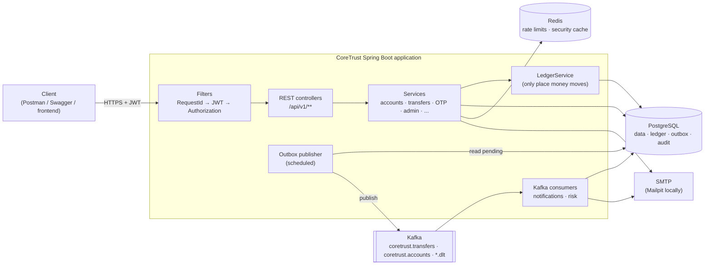

# CoreTrust Bank

A **digital banking backend** built with **Java 21** and **Spring Boot 4**. Customers manage accounts, beneficiaries, transfers, transaction history and statements; bank staff (support and admin) perform assisted operations, investigations and approvals under strict role-based access control.

The focus is on the parts that make banking software hard: **money must never be duplicated, lost or silently overwritten**, every sensitive action must be **authorised and auditable**, and the system must **degrade gracefully** when a supporting service fails.

---

## Highlights

- **Idempotent transfers** — every money movement requires an `Idempotency-Key`; retries and concurrent duplicates move money exactly once (proven by a 10-thread integration test).
- **Ledger with balance snapshots** — each transaction stores the balance after it on both sides, so statements and reconciliation never recompute history.
- **Optimistic locking** — concurrent updates of the same account are detected and retried; no lost updates.
- **Transactional outbox + Kafka** — domain events are written in the same database transaction as the change and published reliably; consumers are idempotent, with retries and dead-letter topics.
- **Maker-checker workflows** — unfreeze requests and transaction reversals are raised by support and approved by a *different* admin.
- **Customer consent via OTP** — staff-assisted operations (withdrawals, assisted transfers, account opening/closing, beneficiaries, phone changes) require a one-time code sent to the customer's email, bound to the exact operation and amount.
- **Single active session** with short-lived JWTs, refresh-token rotation, reuse detection and a fixed maximum session length per role.
- **Redis-backed rate limiting and security caching**, both failing open so a Redis outage never locks customers out.
- **Full audit trail**, including failed attempts and access to the audit log itself.

---

## Key features

**Customers**
- Register, log in (single session, optional forced takeover), extend a session once, log out
- Profile, change password, change email (OTP to the new address), forgot/reset password
- Open up to 5 accounts (SAVINGS / CURRENT), view balances, self-freeze and self-unfreeze with OTP
- Beneficiaries for CoreTrust accounts and other banks, with server-side name/bank autofill
- Idempotent transfers to own accounts or saved beneficiaries
- Transaction history with filters, search, sorting and pagination
- Statements as PDF or CSV; in-app notifications; email alerts for every debit and credit

**Support staff**
- Look up customers, accounts, beneficiaries and transactions
- Assisted operations with customer OTP: account opening and closing, cash withdrawal, assisted transfer, beneficiary addition, phone number change
- Cash deposits, freezing on customer request, unfreeze and reversal requests, disputes
- Assisted customer registration (the customer sets their own password via an emailed link)
- Case updates to customers; optional extra permissions granted by an admin

**Admins**
- Create staff users, grant/revoke permissions (`VIEW_AUDIT_LOGS`, `MANAGE_USERS`, `FLAG_TRANSACTIONS`)
- Approve or reject unfreeze and reversal requests (never their own)
- Lock/unlock users, flag suspicious transactions, resolve disputes
- Search the audit log, run maintenance (cleanup) on demand

---

## Tech stack

| Area | Technology |
|---|---|
| Language / runtime | Java 21 |
| Framework | Spring Boot 4.1, Spring MVC, Spring Security 7, Spring Data JPA |
| Persistence | PostgreSQL, Hibernate 7, Flyway migrations |
| Security | JWT (jjwt 0.12), BCrypt, method-level authorization |
| Caching / rate limiting | Redis (Memurai on Windows for local development) |
| Messaging | Apache Kafka 4 (KRaft mode), Spring Kafka, transactional outbox |
| Email | Spring Mail (Mailpit for local development) |
| Documents | OpenPDF (PDF statements), CSV |
| API documentation | springdoc-openapi (Swagger UI) |
| Observability | Spring Boot Actuator, structured JSON logging (ECS), request-id correlation |
| Testing | JUnit 5, Mockito, Spring MVC slice tests, integration tests on PostgreSQL |
| Build | Maven (wrapper included) |

---

## Architecture overview



The application is a **modular monolith**, organised by feature (`account`, `transfer`, `transaction`, `otp`, ...). Each module owns its controller, service, repository, DTOs and entities. Kafka consumers run in the same process but in separate consumer groups, so they could be extracted into their own services without changing the producers.

Details: [docs/ARCHITECTURE.md](docs/ARCHITECTURE.md) · [docs/DATABASE-DESIGN.md](docs/DATABASE-DESIGN.md) · [docs/SECURITY.md](docs/SECURITY.md)

---

## Roles at a glance

| Capability | CUSTOMER | SUPPORT | ADMIN |
|---|:---:|:---:|:---:|
| Own accounts, transfers, beneficiaries, statements | ✓ | – | – |
| View any customer's data | – | ✓ (customers only) | ✓ |
| Assisted operations with customer OTP | – | ✓ | ✓ |
| Cash deposits | – | ✓ | ✓ |
| Raise unfreeze / reversal requests, disputes | – | ✓ | – |
| Approve unfreeze / reversal requests | – | – | ✓ |
| Lock / unlock users | – | with `MANAGE_USERS` (customers only) | ✓ |
| View audit logs | – | with `VIEW_AUDIT_LOGS` | ✓ |
| Flag transactions | – | with `FLAG_TRANSACTIONS` | ✓ |
| Create staff, grant permissions | – | – | ✓ |

---

## Prerequisites

| Tool | Version | Purpose |
|---|---|---|
| JDK | 21 or newer | Build and run |
| PostgreSQL | 15 or newer (developed on 18) | Main and test databases |
| Redis-compatible server | Redis 7 / Memurai | Rate limiting, security cache |
| Apache Kafka | 4.x (KRaft mode) | Domain events |
| Mailpit | latest | Catches outgoing email locally (web inbox on port 8025) |

Maven does not need to be installed: the project includes the Maven wrapper (`mvnw` / `mvnw.cmd`).

> **Windows notes:** Kafka must live in a path **without spaces** (for example `E:\kafka`). Memurai provides a native Windows Redis-compatible server. No Docker is required for any part of this project.

---

## Local setup

**1. Clone the repository**

```bash
git clone <your-repository-url> coretrust-bank
cd coretrust-bank
```

**2. Create the databases** (as the PostgreSQL superuser)

```sql
CREATE USER coretrust WITH PASSWORD 'coretrust';
CREATE DATABASE coretrust OWNER coretrust;
CREATE DATABASE coretrust_test OWNER coretrust;   -- used by the integration tests
```

**3. Start the supporting services**

| Service | How |
|---|---|
| Redis / Memurai | Runs as a Windows service after installation; check with `memurai-cli ping` → `PONG` |
| Kafka | From the Kafka folder: format the storage once (`kafka-storage random-uuid`, then `kafka-storage format --standalone -t <id> -c config/server.properties`), then `kafka-server-start config/server.properties` |
| Mailpit | Run the Mailpit executable; inbox at <http://localhost:8025> |

The application starts without Redis, Kafka or Mailpit, but runs degraded (no rate limiting or cache, events wait in the outbox, emails retry and fail).

**4. Run the application** (development defaults)

```bash
./mvnw spring-boot:run          # Windows: mvnw spring-boot:run
```

On startup:
- **Flyway** creates or upgrades the schema (`src/main/resources/db/migration`)
- Spring creates the Kafka topics
- A **bootstrap admin** is created if missing, using `app.bootstrap.admin.*` from `application.properties` (development default: `admin@coretrust.com` / `Admin@12345` — change it for anything beyond local use)

**5. Check it's up**

```bash
curl http://localhost:8080/actuator/health      # {"status":"UP"}
```

**6. Explore the API** at <http://localhost:8080/swagger-ui.html> or with the Postman collection (below).

### Startup order

PostgreSQL → Redis/Memurai → Mailpit → Kafka → application.

---

## Configuration

Two profiles are used:

| Profile | File | Purpose |
|---|---|---|
| *(default)* | `application.properties` | Local development: convenient defaults, plain-text logs, Swagger enabled |
| `prod` | `application-prod.properties` | Secrets **only** from environment variables (no defaults — startup fails if any is missing), JSON logs, Swagger disabled, forwarded headers trusted |
| `test` | `src/test/resources/application-test.properties` | Integration tests: `coretrust_test` database, Kafka and Redis cache switched off |

All environment variables used by the `prod` profile are listed in [`.env.example`](.env.example). Spring Boot does not read `.env` files by itself: set the variables in your shell, IDE run configuration or deployment platform.

Running with the production profile locally (PowerShell example):

```powershell
$env:SPRING_PROFILES_ACTIVE="prod"
$env:DB_URL="jdbc:postgresql://localhost:5432/coretrust"
# ... set the other variables from .env.example ...
.\mvnw spring-boot:run
```

Generate a JWT secret (at least 32 random bytes, Base64):

```powershell
$bytes = New-Object byte[] 32; [System.Security.Cryptography.RandomNumberGenerator]::Create().GetBytes($bytes)
[Convert]::ToBase64String($bytes)
```

---

## Running tests

```bash
./mvnw test                                    # all 77 tests
./mvnw test -Dtest="*IntegrationTest"          # integration tests only
./mvnw test -Dtest="!*IntegrationTest"         # unit + web slice tests only (no database needed)
```

| Layer | What it covers | Needs |
|---|---|---|
| Unit tests (JUnit 5 + Mockito) | Domain rules (`Account`), ledger, OTP verification, session refresh rules, admin rules, rate limiter, masking, CSV injection | Nothing |
| Web slice tests (`@WebMvcTest`) | JWT filter outcomes, role and permission rules, validation and error format, idempotency headers | Nothing |
| Integration tests (`@SpringBootTest`) | Concurrent idempotent transfers, no lost updates, ledger reconciliation, auth flow over HTTP, outbox writes, cleanup job | PostgreSQL with `coretrust_test` |

The integration tests rebuild `coretrust_test` from the Flyway migrations on every run, so they also verify the migrations.

---

## API documentation

Swagger UI (development profile only): <http://localhost:8080/swagger-ui.html>

To call protected endpoints:
1. Run `POST /api/v1/auth/login` and copy `accessToken` from the response.
2. Click **Authorize** and paste the token **without** the `Bearer ` prefix.

All endpoints are under `/api/v1`. Errors follow RFC 9457 *Problem Details* with additional `errorCode`, `timestamp` and `requestId` fields:

```json
{
  "title": "Insufficient funds",
  "status": 422,
  "detail": "Insufficient balance.",
  "instance": "/api/v1/transfers",
  "errorCode": "INSUFFICIENT_FUNDS",
  "timestamp": "2026-10-20T06:15:30Z",
  "requestId": "9b2f0c1e-4c7a-4e0e-9d55-0f6b3c2a7e11"
}
```

| Group | Main endpoints |
|---|---|
| Auth | `POST /auth/register`, `/login`, `/refresh`, `/logout`, `/set-password`, `/forgot-password`, `/reset-password` |
| Profile | `GET/PATCH /users/me`, `PATCH /users/me/password`, `POST /users/me/email/otp`, `PATCH /users/me/email` |
| Accounts | `POST/GET /accounts`, `GET /accounts/{id}`, `/{id}/balance`, `/{id}/statement`, `POST /{id}/freeze`, `/{id}/unfreeze/otp`, `/{id}/unfreeze` |
| Beneficiaries | `POST/GET /beneficiaries`, `GET /beneficiaries/{id}`, `/lookup`, `DELETE /beneficiaries/{id}` |
| Transfers | `POST /transfers` (requires `Idempotency-Key`), `GET /transfers/{id}` |
| Transactions | `GET /transactions` (filters, search, paging), `GET /transactions/{id}` |
| Notifications | `GET /notifications`, `/unread-count`, `PATCH /{id}/read`, `/read-all` |
| Assisted (staff) | `/assisted/accounts`, `/assisted/beneficiaries`, `/assisted/deposits`, `/assisted/withdrawals`, `/assisted/transfers`, `/assisted/customers`, `/assisted/statements/email`, `/assisted/case-updates` |
| Workflows | `/accounts/{id}/unfreeze-requests`, `/unfreeze-requests`, `/transactions/{id}/reversal-requests`, `/reversal-requests`, `/transactions/{id}/disputes`, `/disputes` |
| Administration | `/users`, `/users/{id}/lock`, `/unlock`, `/admin/users`, `/admin/users/{id}/permissions`, `/audit-logs`, `/transactions/{id}/flag`, `/unflag`, `/admin/maintenance/cleanup` |
| Operations | `/actuator/health`, `/actuator/health/liveness`, `/actuator/health/readiness`, `/actuator/info` |

---

## Postman collection

File: [`postman/CoreTrust-Bank.postman_collection.json`](postman/CoreTrust-Bank.postman_collection.json)

1. In Postman: **Import** → select the file.
2. Open the collection's **Variables** tab and set `adminPassword` (the bootstrap admin's password; development default in `application.properties`). `baseUrl` defaults to `http://localhost:8080`.
3. Run the collection with the **Collection Runner**, in order. Each run registers fresh demo customers with unique emails and phone numbers, so it can be repeated.

The collection captures tokens and ids automatically, asserts the expected status codes, and includes an **idempotency test** (the same transfer sent twice moves money once), negative cases (bad input, insufficient funds, unauthorised access, reused idempotency keys) and an admin workflow. Requests that need an OTP from Mailpit are in a separate, manual folder.

---

## Project structure

```
src/main/java/com/coretrust/bank
├── account        accounts, freeze/unfreeze, unfreeze requests, assisted opening/closing
├── audit          audit log entity, recording, search
├── auth           register/login/refresh/logout, refresh tokens, password setup & reset
├── beneficiary    beneficiaries, lookup/autofill, assisted add/deactivate
├── caseupdate     support-to-customer case updates
├── cash           deposits and withdrawals
├── common         error handling, DTOs, utilities (masking, hashing, sorting rules)
├── config         security, async, cache, Kafka topics, scheduling, clock, properties
├── dispute        disputes raised by support, resolved by admins
├── idempotency    idempotency records and execution with retries
├── maintenance    nightly cleanup job
├── messaging      transactional outbox, event envelope, processed-event markers
├── notification   in-app notifications, email, event listeners, Kafka notification consumer
├── observability  request-id filter, Kafka health indicator
├── otp            one-time codes bound to operations
├── ratelimit      Redis rate limiter and policies
├── risk           Kafka consumer: auto-flags high-value transfers, failure alerts
├── security       JWT service and filter, principal, entry points, cache eviction
├── statement      PDF/CSV statements
├── transaction    ledger, transactions, history queries, reversals, flagging
├── transfer       customer and assisted transfers
└── user           users, permissions, staff onboarding, profile and admin services
```

---

## Project status and limitations

**Implemented:** everything listed under *Key features*, with 77 automated tests, Flyway-managed schema, production profile and health checks.

**Not supported (by design or out of scope):**
- Transfers only between **CoreTrust accounts**; no external payment rails (NEFT/IMPS/UPI). Beneficiaries at other banks can be saved but not paid.
- Single currency (**INR**); no foreign exchange.
- No KYC verification, no frontend, no multi-factor authentication for login.
- OTPs are delivered by **email only** (no SMS).
- No containerisation, CI pipeline or cloud deployment in this repository; the setup targets local development on Windows without Docker.
- Kafka events on `coretrust.accounts` are published but not yet consumed; deposit, withdrawal and reversal alert emails use in-process events, while transfer alerts go through Kafka.
- Closed accounts cannot be reopened; customers open a new account instead.

See [docs/SECURITY.md](docs/SECURITY.md#known-limitations) for security-specific limitations.
