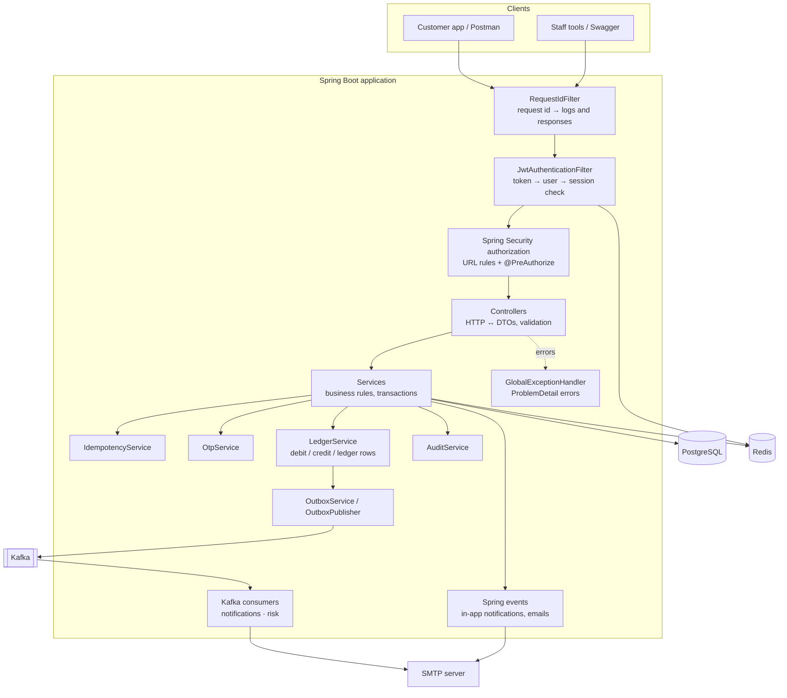
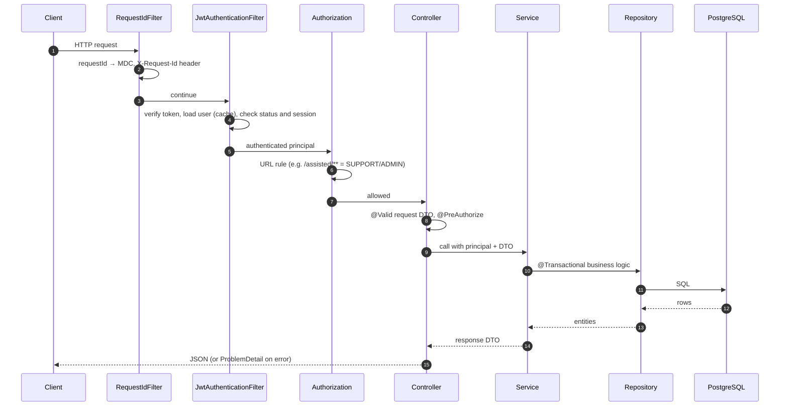
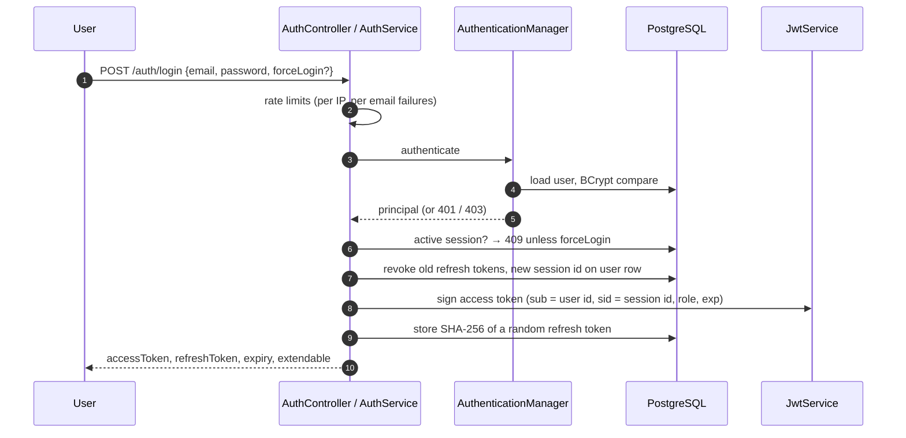
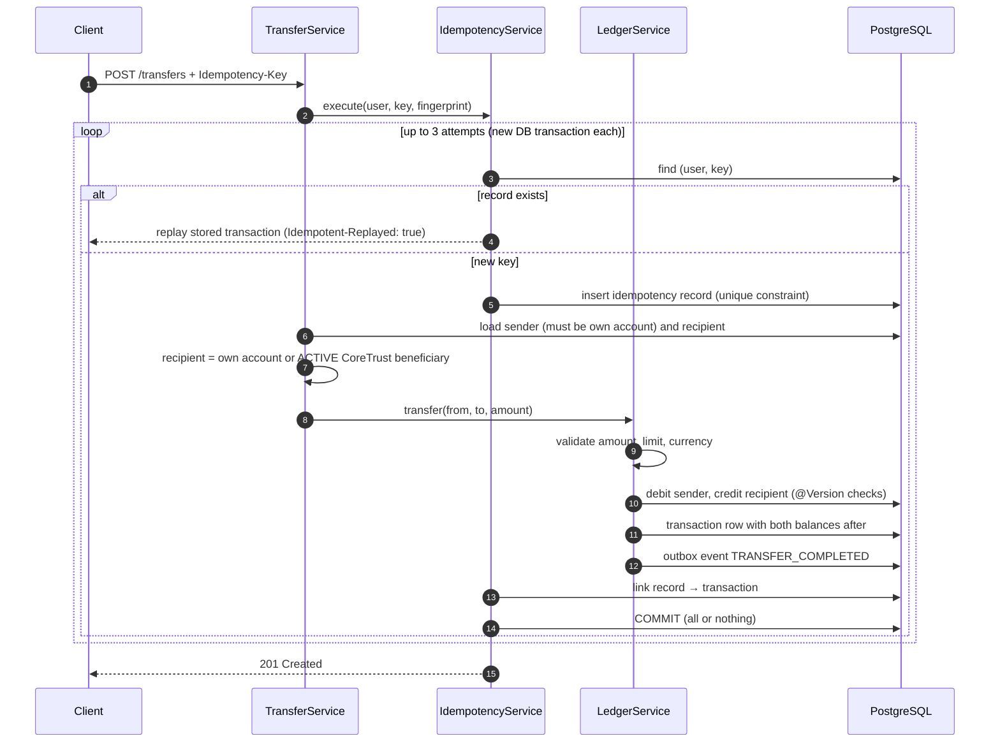
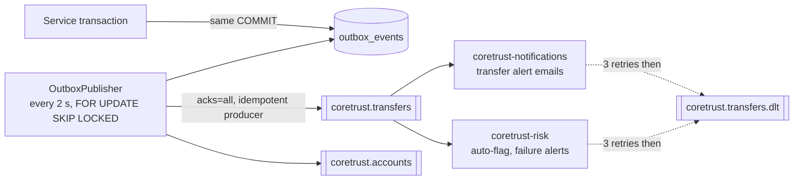

# Architecture

This document explains how CoreTrust Bank is structured and how requests flow through it.

## 1. Big picture

CoreTrust is a **modular monolith**: one Spring Boot application, organised by business feature rather than by technical layer. Each module (for example `account`, `transfer`, `otp`) contains its own controllers, services, repositories, DTOs and entities.

| Component | Role |
|---|---|
| **PostgreSQL** | Source of truth: users, accounts, ledger, workflow requests, outbox, audit log |
| **Redis** | Rate-limit counters and a 60-second cache of the per-request security lookup. Optional: the app fails open without it |
| **Kafka** | Durable event stream for transfers and account changes; consumed by the notification and risk consumers |
| **SMTP (Mailpit locally)** | OTPs, setup and reset links, alerts, statements |

## 2. Module breakdown

| Module | Responsibility |
|---|---|
| `auth` | Registration, login, session extension, logout, password setup and reset links |
| `user` | Profile, password and email changes, staff onboarding, user administration, permissions |
| `security` | JWT creation and parsing, the authentication filter, the security principal, 401/403 handlers |
| `account` | Account lifecycle: open, freeze, unfreeze (self-service and maker-checker), close |
| `beneficiary` | Saved payees, lookup/autofill, assisted add and deactivate |
| `transfer` | Customer and staff-assisted transfers, built on the ledger and idempotency |
| `cash` | Branch deposits and OTP-protected withdrawals |
| `transaction` | Ledger (`LedgerService`), history queries, reversal requests, flagging |
| `idempotency` | Stores key → transaction and replays duplicates |
| `otp` | One-time codes bound to a specific operation |
| `statement` | PDF and CSV statements built from the ledger |
| `dispute` | Disputes raised by support and resolved by admins |
| `notification` | In-app notifications, email sending, event listeners, the Kafka notification consumer |
| `caseupdate` | Manual case updates from support to customers |
| `messaging` | Transactional outbox, event envelope, processed-event markers |
| `risk` | Kafka consumer that auto-flags high-value transfers and raises failure alerts |
| `audit` | Recording and searching the audit trail |
| `ratelimit` | Redis-based rate limiting with configurable policies |
| `maintenance` | Nightly cleanup of expired technical data |
| `observability` | Request-id correlation, Kafka health indicator |
| `common` / `config` | Error handling, shared DTOs and utilities, Spring configuration |

## 3. Request lifecycle

Every request passes through the same layers:

Design rules:
- **Controllers are thin**: map HTTP to service calls, no business logic.
- **Services own transactions** (`@Transactional`), and **entities protect their own invariants** (`Account.debit()`, `Account.freeze()`, `UnfreezeRequest.approve()`), so rules can't be bypassed by a new feature.
- **DTOs only** cross the API boundary. Entities never leave the service layer, which keeps password hashes, lazy relations and internal fields out of responses.
- `spring.jpa.open-in-view=false`: all lazy loading happens inside service transactions.

## 4. Authentication flow

**On every later request**, `JwtAuthenticationFilter`:
1. Verifies the signature, issuer and expiry (`TOKEN_EXPIRED` / `INVALID_TOKEN`).
2. Loads the user's security details by id (from a 60-second Redis cache, evicted after any change to the user).
3. Rejects locked or inactive users, and tokens whose `sid` no longer matches the user's active session (`SESSION_REVOKED`), which makes logout, force-login, password changes and locks effective immediately.
4. Puts the principal into the security context and the user id into the logging context.

**Session policy** (per role, configurable):

| Role | First token | One extension | Fixed session end |
|---|---|---|---|
| CUSTOMER, ADMIN | 15 min | until minute 30 | 30 min |
| SUPPORT | 30 min | until minute 60 | 60 min |

The refresh token expires with the first access token, so a session can be extended only once and only before it lapses. Refresh tokens rotate on use; reuse of a rotated token revokes the whole session.

## 5. Money-transfer flow

- **One transaction boundary** covers the idempotency record, both balance updates, the ledger row, the audit entry and the outbox event. Any failure rolls back everything.
- **Business failures** (insufficient funds, frozen sender, limit exceeded) roll back the transfer, but a `TRANSFER_FAILED` outbox event is written in a separate transaction (`REQUIRES_NEW`) for monitoring. Failed attempts don't consume the idempotency key.
- **Frozen accounts** can receive money but not send it; closed accounts can do neither.
- **Assisted transfers** follow the same path, with a customer OTP verified inside the same transaction.

## 6. Concurrency and idempotency

| Problem | Mechanism |
|---|---|
| Client retries after a timeout | Idempotency key per user; same key + same request returns the original result |
| Same key reused for a different request | Request fingerprint (SHA-256 of normalised fields) → `422 IDEMPOTENCY_KEY_REUSED` |
| Two identical requests at the same instant | Unique constraint on `(user_id, idempotency_key)`: the second insert waits, fails, and the retry replays the committed result |
| Two different transfers from one account at once | `@Version` on `Account` (optimistic locking); the losing transaction retries, up to 3 times, then returns `409` |
| Two admins approving the same request | `@Version` and a PENDING → APPROVED state machine; the second approval fails |
| Same OTP used twice concurrently | `@Version` on `Otp`; consumption commits only with the protected operation |

These guarantees are verified by integration tests that run 10 concurrent requests against PostgreSQL.

## 7. Error handling

`GlobalExceptionHandler` turns every exception into an RFC 9457 `ProblemDetail` with `errorCode`, `timestamp` and `requestId`:

| Source | Example | Status / code |
|---|---|---|
| Bean Validation on DTOs | missing field, bad pattern | 400 `VALIDATION_FAILED` with an `errors` map |
| Bad JSON / missing header / wrong type | `?status=BANANA` | 400, listing allowed values |
| `BusinessException` | insufficient funds, invalid state | status from `ErrorCode` (409, 422, ...) |
| Authentication | missing or expired token | 401 `UNAUTHORIZED` / `TOKEN_EXPIRED` / `INVALID_TOKEN` / `SESSION_REVOKED` |
| Authorization | wrong role or permission | 403 `ACCESS_DENIED` |
| Concurrency | optimistic lock exhausted | 409 `CONCURRENT_MODIFICATION` |
| Rate limits | too many attempts | 429 `TOO_MANY_REQUESTS` + `Retry-After` |
| Anything else | unexpected bug | 500 `INTERNAL_ERROR`; stack trace logged, never returned |

Errors raised inside servlet filters (for example by the JWT filter) are routed through the same handler via `HandlerExceptionResolver`, so they share the format.

## 8. Background processing and events

### In-process (Spring events)

Services publish events such as `AccountFrozenEvent` or `AccountAlertEvent`:

| Listener phase | Used for | Why |
|---|---|---|
| `BEFORE_COMMIT` | In-app notifications | Saved in the same transaction: a notification exists exactly when the change does |
| `AFTER_COMMIT` + async pool | Emails | An email can't be rolled back, so it waits for the commit; a dedicated, bounded thread pool with 3 retries keeps API responses fast |

### Kafka (transactional outbox)

- **Events:** `TRANSFER_COMPLETED`, `TRANSFER_FAILED`, `ACCOUNT_CREATED`, `ACCOUNT_FROZEN`, wrapped in an envelope with a unique `eventId`. Payloads carry ids and amounts, never names, emails or internal notes.
- **Delivery:** at-least-once publishing; consumers are idempotent through `processed_events` (consumer + event id), stored in the same transaction as their side effects.
- **Failures:** retries with exponential backoff (1 s, 2 s, 4 s); malformed messages skip retries and go straight to the dead-letter topic.
- **Ordering:** events are keyed by aggregate id, so events about one transaction or account stay in order; the publisher stops at the first failed send.
- **Outages:** if Kafka is down, the API keeps working; events wait in the outbox and are published once Kafka is back.

### Scheduled jobs

| Job | Schedule | Purpose |
|---|---|---|
| Outbox publisher | every 2 s | Send pending events to Kafka |
| Cleanup | 03:00 IST nightly (and on demand by admins) | Delete expired refresh tokens, OTPs, setup/reset tokens, old idempotency records, processed-event markers and published outbox rows, in batches of 1,000 |

## 9. Observability

- **Request ids:** every request gets an `X-Request-Id` (or keeps a safe client-supplied one). It appears on every log line, in background email threads, and in every error response.
- **Logs:** plain text locally; JSON (Elastic Common Schema) in the `prod` profile.
- **Health:** `/actuator/health` (public status; details for admins) covering PostgreSQL, Redis, mail, Kafka and disk. Readiness depends only on the database, because Redis, Kafka and mail failures degrade the service rather than stop it.
