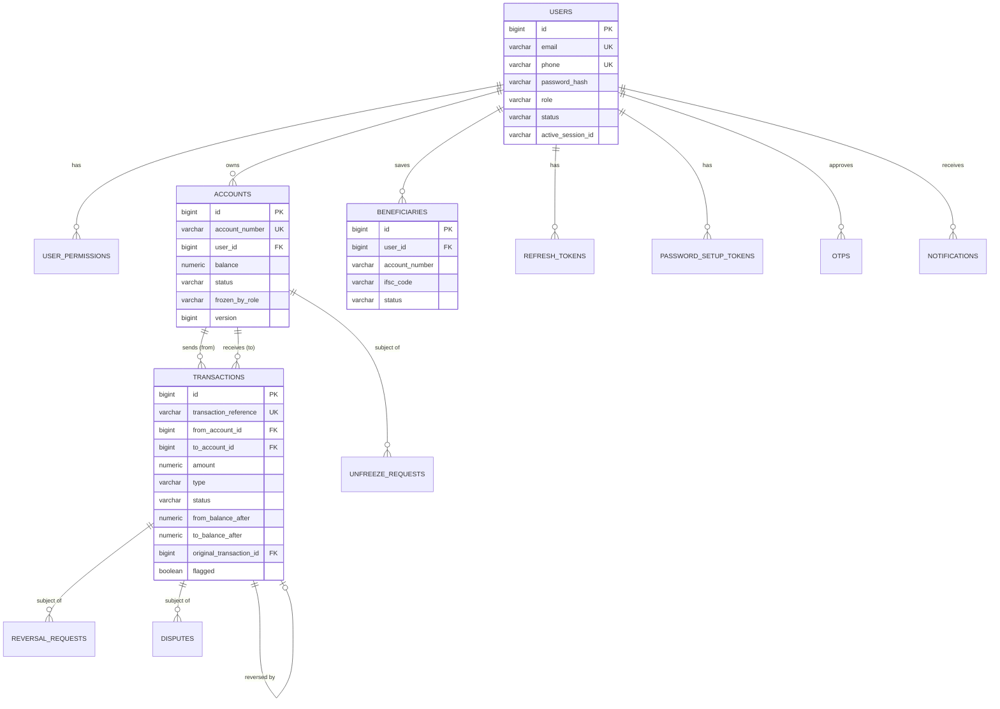

# Database design

CoreTrust uses **PostgreSQL** as its single source of truth. The schema is managed by **Flyway** migrations, and Hibernate only validates it at startup (`ddl-auto=validate`).

> The authoritative definition is `src/main/resources/db/migration`. This document explains the design; if the two ever differ, the migrations win.

## 1. Entity-relationship diagram

Tables without foreign keys to business data — `audit_logs`, `idempotency_records`, `outbox_events`, `processed_events` — are intentionally decoupled (see §4).

## 2. Tables

### Identity and access

| Table | Purpose | Key columns |
|---|---|---|
| `users` | Customers and staff | `email` and `phone` unique; `role` (CUSTOMER/SUPPORT/ADMIN); `status` (ACTIVE/INACTIVE/LOCKED); `password_hash` (BCrypt); `active_session_id` + `session_valid_until` (single-session enforcement) |
| `user_permissions` | Extra permissions granted to support users | `(user_id, permission)`; values `VIEW_AUDIT_LOGS`, `MANAGE_USERS`, `FLAG_TRANSACTIONS` |
| `refresh_tokens` | Rotating refresh tokens | `token_hash` (SHA-256, unique); `session_id`; `expires_at`; `session_expires_at` (fixed session end); `revoked`; `extended` |
| `password_setup_tokens` | One-time setup and reset links | `token_hash` unique; `purpose` (ACCOUNT_SETUP/PASSWORD_RESET); `expires_at`; `used_at` |
| `otps` | Customer consent codes | `code_hash` (BCrypt); `operation_hash` (SHA-256 of the exact operation); `purpose`; `expires_at`; `attempts` / `max_attempts`; `consumed`; `version` |

### Banking

| Table | Purpose | Key columns |
|---|---|---|
| `accounts` | Customer accounts | `account_number` unique; `user_id` FK; `account_type` (SAVINGS/CURRENT); `balance numeric(19,2)` with `CHECK (balance >= 0)`; `currency`; `status` (ACTIVE/FROZEN/CLOSED); `frozen_by_role`; `closed_at`; `version` (optimistic lock) |
| `beneficiaries` | Saved payees | unique `(user_id, account_number)`; `ifsc_code`; `status` (ACTIVE/INACTIVE — soft delete) |
| `transactions` | The ledger | `transaction_reference` unique; `from_account_id` / `to_account_id` (nullable for deposits / withdrawals); `amount numeric(19,2)` with `CHECK (amount > 0)`; `type` (DEPOSIT/WITHDRAWAL/TRANSFER/REVERSAL); `status` (SUCCESS/REVERSED/...); `from_balance_after` / `to_balance_after`; `original_transaction_id` (for reversals); `initiated_by_id`; flag columns |

### Workflows

| Table | Purpose | Key columns |
|---|---|---|
| `unfreeze_requests` | Support raises, admin approves | `account_id` FK; requester and reviewer id/email; `status` (PENDING/APPROVED/REJECTED/CANCELLED); `version` |
| `reversal_requests` | Support raises, admin approves | `transaction_id` FK; requester/reviewer; `status`; `reversal_transaction_id`, `reversal_reference`; `version` |
| `disputes` | Customer complaints about a transaction | `transaction_id` FK; `category`; `status` (OPEN/RESOLVED/REJECTED); resolver and note; `version` |

### Communication, audit and infrastructure

| Table | Purpose | Key columns |
|---|---|---|
| `notifications` | In-app inbox | `user_id` FK; `type`; `title`; `message`; `status` (UNREAD/READ); `read_at` |
| `audit_logs` | Append-only audit trail | `user_id`, `actor_email`, `action`, `entity_type`, `entity_id`, `description`, `occurred_at`, `ip_address` — no foreign keys, never updated |
| `idempotency_records` | Exactly-once money movement | unique `(user_id, idempotency_key)`; `operation`; `request_hash`; `transaction_id` |
| `outbox_events` | Events waiting for Kafka | `event_id` unique; `topic`; `event_key`; `event_type`; `payload` (JSON text); `published_at`; `attempts`; `last_error` |
| `processed_events` | Consumer de-duplication | unique `(consumer, event_id)`; `processed_at` |
| `flyway_schema_history` | Applied migrations (managed by Flyway) | version, checksum, success |

Most tables also have `created_at` and `updated_at` (`timestamp with time zone`, filled by JPA auditing). All primary keys are `bigint` identity columns. Enum values are stored as **text** (never ordinal numbers), so reordering an enum can never corrupt data.

## 3. Relationships

| Relationship | Rule |
|---|---|
| User → accounts | One-to-many; a customer may hold up to 5 non-closed accounts (service rule, configurable) |
| User → beneficiaries | One-to-many; one entry per target account number |
| Account → transactions | Each transaction references up to two accounts: `from` (debited) and `to` (credited) |
| Transaction → transaction | A REVERSAL row points to the transaction it undoes (`original_transaction_id`) |
| Account / transaction → requests and disputes | Many-to-one; at most one PENDING/OPEN request per subject (service rule) |

All `@ManyToOne` associations are **lazy**; list endpoints use entity graphs or batch fetching to avoid N+1 queries.

## 4. Constraints and indexes

**Integrity enforced by the database** (a safety net under the service rules):

| Constraint | Protects against |
|---|---|
| `CHECK (balance >= 0)` on accounts | Negative balances, even if a bug bypassed `Account.debit()` |
| `CHECK (amount > 0)` on transactions | Zero or negative movements |
| Unique `account_number`, `transaction_reference`, `email`, `phone` | Duplicates under concurrent creation |
| Unique `(user_id, idempotency_key)` | Two concurrent copies of the same request both executing |
| Unique `(consumer, event_id)` | A Kafka event being processed twice |
| Named foreign keys (e.g. `fk_accounts_user`) | Orphan rows; readable errors |
| CHECK constraints on enum columns | Invalid status/type values |

**Deliberately without foreign keys:** `audit_logs` (history must survive changes to the data it describes), `idempotency_records`, `outbox_events` and `processed_events` (technical tables with their own lifecycle and cleanup).

**Indexes, chosen from real queries:**

| Index | Query it serves |
|---|---|
| `transactions (from_account_id, created_at)` and `(to_account_id, created_at)` | Account history and statements, newest first; combined by PostgreSQL for "from OR to" filters |
| `transactions (status)` | Status filters |
| `accounts (user_id)`, `beneficiaries (user_id)`, `refresh_tokens (user_id)` | "Everything belonging to this user" |
| `audit_logs (entity_type, entity_id)`, `(user_id)`, `(occurred_at)` | Investigation queries: one entity's full history, one actor, a time range |
| `notifications (user_id, status)` | Unread badge and inbox |
| `otps (user_id, purpose)` | Invalidate the previous code when a new one is issued |
| **Partial index** `outbox_events (id) WHERE published_at IS NULL` (V2) | The publisher's poll; stays tiny however many events were ever sent |

## 5. Money representation

- Amounts and balances are `numeric(19,2)` in PostgreSQL and `BigDecimal` in Java — **never** `float`/`double`, which cannot represent values like 0.10 exactly.
- Comparisons use `compareTo` / `signum()`, never `equals` (which also compares scale: `5.0 ≠ 5.00`).
- Requests accept at most two decimal places (`@Digits(fraction = 2)` plus a service check).
- Currency is stored per account and per transaction (`INR` today); cross-currency transfers are rejected.

## 6. Transfer consistency

A transfer is one database transaction containing:

1. the idempotency record,
2. the sender's debit and the recipient's credit (each with an optimistic-lock version check),
3. the ledger row with both balances after,
4. the audit entry,
5. the `TRANSFER_COMPLETED` outbox event.

Either all of them commit or none do. There is no state where money left one account without arriving in the other, or where a transfer happened without its event.

## 7. Ledger design

`transactions` is an **append-only ledger**:

- Each row records the movement **and** a snapshot of the balance after it, on each affected side (`from_balance_after`, `to_balance_after`).
- Corrections never update or delete history: a **reversal** is a new REVERSAL row moving the money back, linked to the original, whose status becomes REVERSED.
- **Statements** take the opening balance from the last row before the period and list rows in order, so a statement never recomputes history.
- **Reconciliation invariant** (verified by an integration test): for every account, the balance equals the latest ledger row's balance-after, and internal transfers never change the sum of all balances.

| Type | from_account | to_account |
|---|---|---|
| DEPOSIT | – | credited |
| WITHDRAWAL | debited | – |
| TRANSFER | debited | credited |
| REVERSAL | the original recipient (debited) | the original sender (credited) |

## 8. Flyway migration strategy

- **Location:** `src/main/resources/db/migration`
- **Naming:** `V<version>__<description>.sql` — capital `V`, **two** underscores, e.g. `V2__outbox_pending_partial_index.sql`
- **Baseline:** `V1__baseline.sql` was generated from the JPA entities, then owned by hand from then on.
- **Applying:** at startup, Flyway runs pending migrations in version order and records each in `flyway_schema_history` with a checksum; then Hibernate validates the schema against the entities and refuses to start on a mismatch.
- **Rules:**
  1. Every schema change is a new migration, committed together with the entity change.
  2. Never edit a migration that has run anywhere — Flyway's checksum check would stop the application. Mistakes are fixed with a new migration.
  3. Adding a value to an enum column means a migration that drops and recreates its CHECK constraint.
  4. Adding a `NOT NULL` column to a table with data needs a default or a backfill in the migration.
- **Tests:** the test profile cleans `coretrust_test` and rebuilds it from the migrations on every run, so the migrations are tested as part of the suite. `clean` is disabled everywhere else.

## 9. Concurrency control

- **Optimistic locking** (`@Version`) on `accounts`, `otps`, `unfreeze_requests`, `reversal_requests` and `disputes`: an update includes `WHERE version = ?`; if another transaction changed the row first, nothing is updated and the transaction fails instead of overwriting.
- **Automatic retries:** money movements retry up to 3 times, each in a fresh transaction, before returning `409 CONCURRENT_MODIFICATION`.
- **Unique constraints as locks:** a concurrent duplicate insert of an idempotency key waits for the first transaction and then fails, turning a race into a clean replay.
- **`FOR UPDATE SKIP LOCKED`:** lets several publisher instances work on the outbox without blocking each other or sending the same event twice in parallel.
- **Isolation level:** PostgreSQL's default `READ COMMITTED`, which is sufficient because the critical updates are protected by version checks and constraints.
